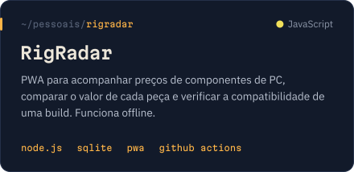
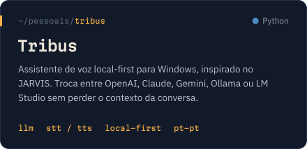
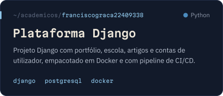
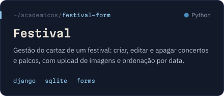
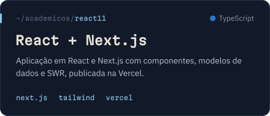
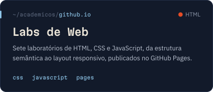

<p align="center">
  
</p>

## Sobre mim

Sou o **Francisco Graça**, estudante de **Engenharia Informática**. Interessa-me perceber como os sistemas funcionam, onde falham e como se protegem, e gosto de transformar ideias em aplicações que se usam no dia a dia.

```text
[segurança]   compreender sistemas e as suas vulnerabilidades
[apps]        transformar ideias em aplicações
[aprender]    construir bases sólidas, um projeto de cada vez
```

## Projetos pessoais

<p align="center">
  <a href="https://github.com/FranciscoGraca1/RigRadar"></a>
  <a href="https://github.com/FranciscoGraca1/Tribus"></a>
</p>

## Projetos académicos

<p align="center">
  <a href="https://github.com/FranciscoGraca1/franciscograca22409338"></a>
  <a href="https://github.com/FranciscoGraca1/festival-form-a22409338"></a>
  <a href="https://github.com/FranciscoGraca1/react11"></a>
  <a href="https://github.com/FranciscoGraca1/FranciscoGraca1.github.io"></a>
</p>

<sub>Também por aqui: <a href="https://github.com/FranciscoGraca1/festival">festival</a>, a primeira versão do projeto Festival, e <a href="https://github.com/FranciscoGraca1/Data-Science">Data-Science</a>, um fork dos materiais da UC de Ciência de Dados.</sub>

## Stack

```text
linguagens    C, Python, JavaScript, TypeScript, Kotlin
web           Django, Next.js, React, Node.js, Tailwind CSS
dados         SQLite, PostgreSQL, Jupyter
ferramentas   Git, GitHub Actions, Docker, Vercel
```

## Atividade

<picture>
  <source media="(prefers-color-scheme: dark)" srcset="https://raw.githubusercontent.com/FranciscoGraca1/FranciscoGraca1/main/assets/github-contribution-grid-snake-dark.svg" />
  
</picture>

<p align="center">
  
</p>

<!-- CURRENTLY:START -->
<p align="center"><sub>Último push público: <a href="https://github.com/FranciscoGraca1/RigRadar">RigRadar</a>, em JavaScript, a 01/10/2026.</sub></p>
<!-- CURRENTLY:END -->

## Contacto

Escreve-me para [franciscofilipegraca@gmail.com](mailto:franciscofilipegraca@gmail.com) ou fala comigo no [LinkedIn](https://www.linkedin.com/in/francisco-gra%C3%A7a-08453b220/).

<p align="center"><sub><code>~ $ exit</code> &nbsp; a próxima linha ainda está por escrever.</sub></p>
